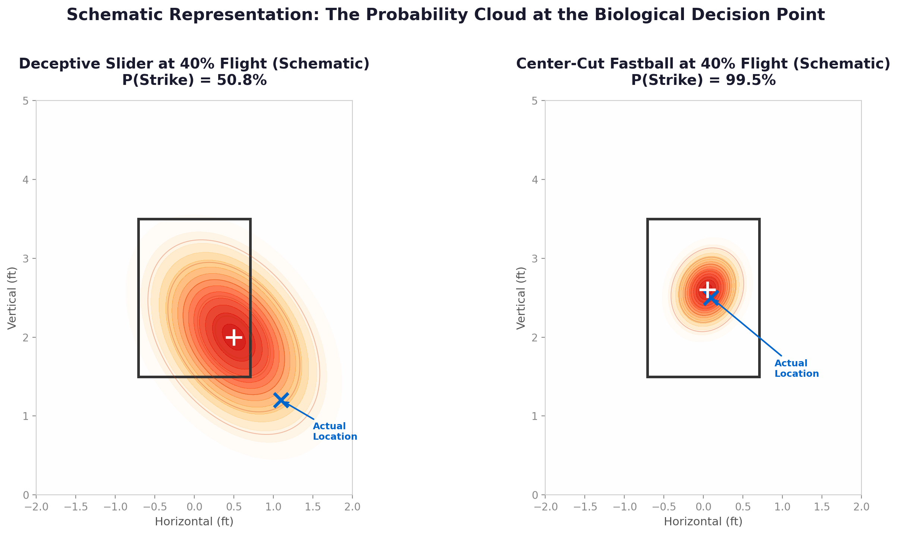
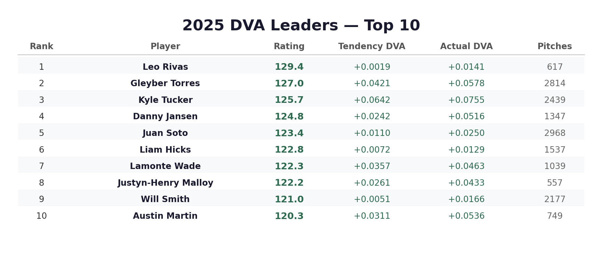
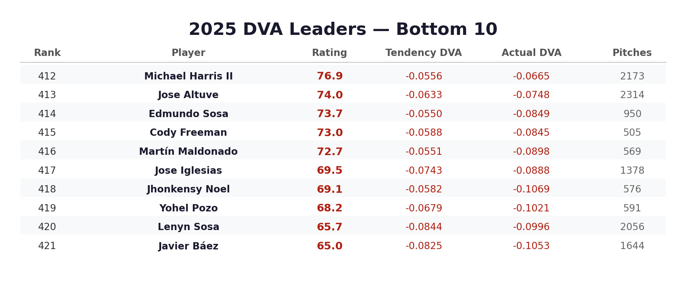
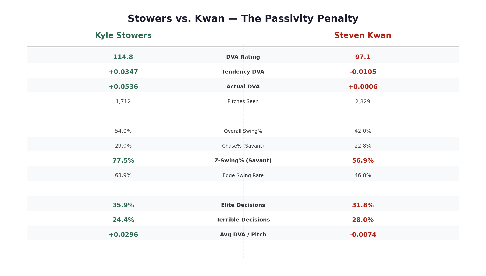
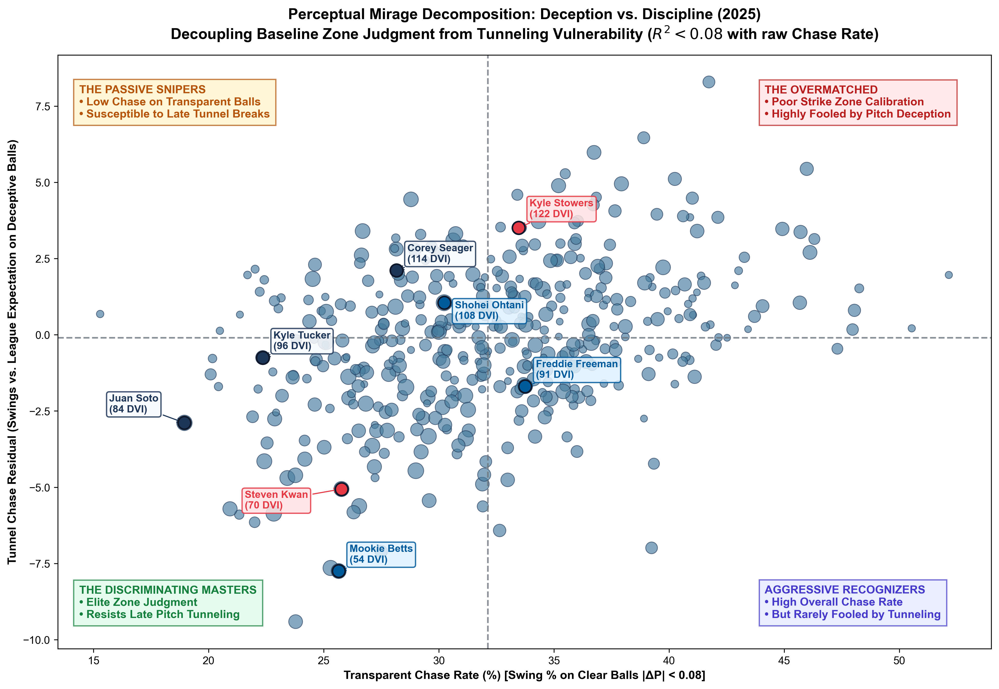
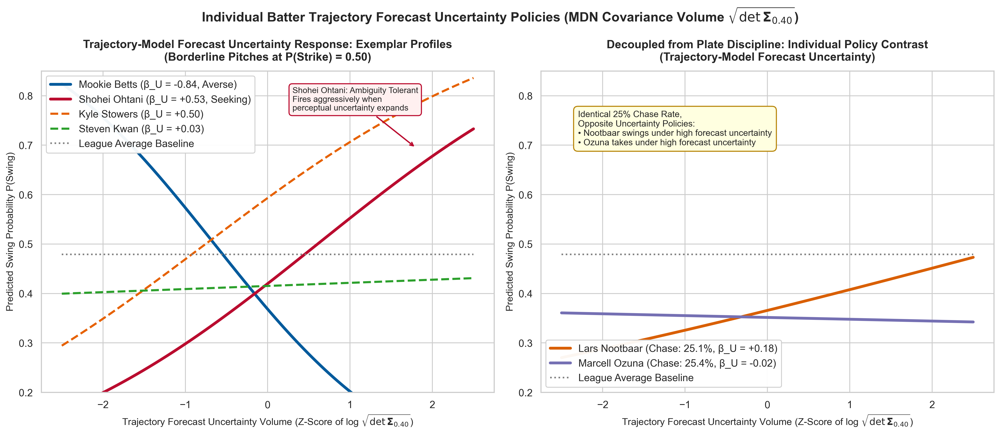
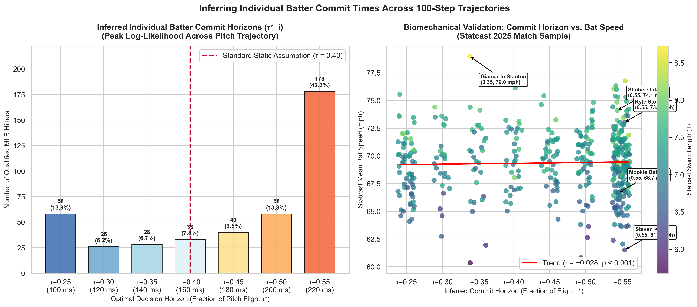

# Strike Zone Perception & Bayesian Swing Decision Engine

[](https://www.python.org/downloads/)
[](https://pytorch.org/)
[](https://xgboost.readthedocs.io/)
[](https://opensource.org/licenses/MIT)
[]()

> **Research and presentation by Chris Song** presented at the **SABR / SAGB Conference**.  
> Materials and slides available in [`docs/presentation/`](docs/presentation/).  
> *Note on Provenance:* The slide deck (`docs/presentation/SAGB Conference Presentation - Chris Song.pdf`) is a historical conference artifact; current authoritative leaderboards, models, and empirical evaluations reside in [`data/leaderboards/`](data/leaderboards/) and SQLite (`data/mlb.db`), generated by the production Empirical Bayes EV-DVA (`ev_dva_eb`, `alignment_dva_eb`) pipeline.

---

## ⚾ Overview

In Major League Baseball, traditional plate discipline metrics like **Chase Rate (O-Swing%)**, **Zone Swing Rate (Z-Swing%)**, and **SwStr%** evaluate batter decisions against a binary, rectangular strike zone using final pitch locations measured at home plate ($y = 1.417\text{ ft}$).

In reality, human batters do not possess 20/20 hindsight. Batters must commit to a swing or take decision **~175 ms after release** (approximately **40% of pitch flight**), when the ball is still 30+ feet away:

<p align="center">
  
</p>

This repository establishes **a probabilistic framework for evaluating MLB swing decisions relative to early-trajectory strike-location forecasts and count-adjusted expected values, with empirical analyses of spatial uncertainty sensitivity, trajectory belief reversals, and information-use timing**:

1. **Streaming Trajectory Perception:** An LSTM with a Bivariate Gaussian Probabilistic Output Head (Single-Component $K=1$ MDN) processes 9D kinematic features $(x, y, z, v_x, v_y, v_z, a_x, a_y, a_z)$ at each millisecond of flight, estimating a 2D Gaussian belief distribution $(\mu_x, \mu_z, \sigma_x, \sigma_z, \rho)$ over plate-crossing location.
2. **Exact Chebyshev Strike Zone Integration:** At the standardized 40% flight decision point (`DEFAULT_DECISION_FRAC = 0.40`, ~175 ms), we evaluate the exact bivariate normal CDF over the rectangular strike zone bounds ($L_\infty$) via Owen's T function, fully incorporating cross-axis spatial correlation $\rho$.
3. **Dual Baseline League Swing Models:** Evaluates batter decisions against two explicit, decoupled baselines trained via 5-fold batter-grouped cross-validation (`GroupKFold`):
   - **Objective Post-Hoc Baseline (`FINAL_LOCATION_FEATURES`):** Conditioned on where the pitch actually arrived at home plate (`plate_x, plate_z, in_zone, dist_from_center`).
   - **Perceptual Decision-Time Baseline (`DECISION_TIME_FEATURES`):** Conditioned exclusively on early-trajectory information available to the batter at $t=0.40$ (`lstm_p_strike, mu_x, mu_z, sigma_x, sigma_z, rho, pitch_type, release_speed`).
   - *Deception Metric:* The divergence $\hat{p}_{\text{swing}}(\text{Perceptual}) - \hat{p}_{\text{swing}}(\text{Post-Hoc})$ directly quantifies how much early ball flight induces swings beyond where the pitch actually arrived.
4. **Count-Dependent Expected Value DVA (`EV-DVA`) & Empirical Bayes Shrinkage:** Evaluates **Expected Value Decision Value Added (EV-DVA)** as **estimated value under the chosen utility assumptions** (empirical RE24 count-transition run values and out-of-fold baseline models), shrunk via data-driven Empirical Bayes ($K^* = \sigma^2_w / \tau^2_b$). Historical strike-alignment DVA (2020–2024) is retained alongside for direct zone-accuracy benchmarking.

> [!NOTE]
> **Scientific Modeling Framing & Core Takeaway:** Trajectories are reconstructed from Statcast initial conditions to model the normative physical upper bound of strike-location information available from early pitch flight ($P(\text{Strike} \mid \mathcal{F}_{0.40})$). Uncertainty is evaluated strictly as **trajectory-model forecast uncertainty** rather than biological sensory noise. Inferred horizons $\tau^*_i$ represent **exploratory fitted indices** of empirical information-use timing, and EV-DVA represents **estimated value under the chosen utility assumptions**. Overall, **the framework offers an interpretable way to evaluate decisions under trajectory uncertainty, shows repeatable player variation, and motivates further validation of predictive and behavioral extensions.**

---

## 🏆 2025 DVA Leaderboard Highlights

### Top 10 Decision Makers (2025 MLB Season)
<p align="center">
  
</p>

### Bottom 10 Decision Makers (2025 MLB Season)
<p align="center">
  
</p>

*Full 532-player leaderboard is available at [`data/leaderboards/2025_dva_leaderboard.csv`](data/leaderboards/2025_dva_leaderboard.csv).*

---

## 🔬 Modeling Tracks

The repository contains three complementary modeling approaches:

### Track 1: Modern LSTM Perception & Bayesian DVA Engine *(Primary Pipeline)*
- **Trajectory Sequencing:** Left-padded $(100, 9)$ tensors resampled uniformly across flight duration.
- **Model Architecture:** [`PitchPerceptionLSTM`](src/model.py) with 2-layer LSTM + Bivariate Gaussian Probabilistic Output Head ($K=1$ MDN) predicting $(\mu_x, \mu_z, \sigma_x, \sigma_z, \rho)$.
- **Scoring Engine:** [`LSTMEyeScorer`](src/lstm_scoring.py) computes $P(\text{Strike})$ at standardized 40% flight (`decision_frac = 0.40`) using bivariate normal integration (`_bvn_cdf`).
- **Baseline Engine:** [`LeagueSwingModel`](src/swing_model.py) trained with untouched 5-fold batter-grouped out-of-fold cross-validation (`GroupKFold`) supporting both `final_location` and `decision_time` baselines.
- **Metric Formulation:** $\text{DVA} = \text{Tendency DVA} + \text{Actual DVA}$
  - $\text{Tendency DVA}$: True-talent posterior swing tendency deviation from league prior via Beta-Binomial conjugacy.
  - $\text{Actual DVA}$: Observed swing decision value relative to baseline expectation, shrunk toward zero via empirical Bayes prior ($K = 15.0$).
  - $\text{EV-DVA}$: Count-dependent run expectancy value added relative to count transition baselines.

### Track 2: Classical Additive Physical Eye Scorer
- **Module:** [`FastEyeScorer`](src/scoring.py)
- **Mechanism:** Vectorized maximum-likelihood estimation (MLE) over swing decisions assuming an additive variance model: $\text{Var}_{\text{total}} = \text{Var}_{\text{phys}} + \sigma_{\text{vis}}^2$

### Track 3: Biophysical Monte Carlo & Bayesian Fusion
- **Modules:** [`generate_pitch_cloud`](src/uncertainty.py) & [`PerceptualCloud`](src/perception.py)
- **Mechanism:** Perturbs initial release mechanics with multivariate Gaussian physical noise, then performs Kalman-style continuous Bayesian fusion with distance-dependent visual acuity $\sigma_{\text{vis}}(y)$.
- **3D Visualization:** Interactive 3D trajectory cloud available at [`assets/perceptual_cloud_3d.html`](assets/perceptual_cloud_3d.html).

---

## 📊 Analytical Insights: Case Studies

### Kyle Stowers vs. Steven Kwan (40% Decision Point)
Traditional metrics credit Steven Kwan with elite plate discipline due to low chase rates. However, when evaluating the biological decision point under uncertainty, Kwan frequently takes borderline pitches that appear to be strikes, whereas Kyle Stowers displays aggressive, high-expected-value swing decisions on pitches with high strike probabilities:

<p align="center">
  
</p>

Run this comparison directly:
```bash
python3 analysis/compare_stowers_kwan_40.py --year 2025
```

---

## 🧠 Advanced Perceptual Extensions

This repository includes four cutting-edge perceptual modeling extensions designed to evaluate late movement, biological uncertainty, individual decision timing, and full-pipeline holdout validity:

### 1. Deception vs. Discipline: The Perceptual Mirage Decomposition (ΔP)

Compares the streaming LSTM early strike belief ($t = 0.40$, ~175 ms) against ground-truth plate arrival ($t = 1.0$), separating true trajectory deception from ordinary binomial calibration variance:

$$
\Delta P_i = P(\text{Strike} \mid \mathcal{F}_{0.40})_i - \mathbf{1}(\text{True Strike})_i
$$

- **True Perceptual Reversals vs. Prediction Discrepancies:** Strictly separates meaningful perceptual reversals (pitches crossing the $0.50$ decision threshold: $P_{0.40} \ge 0.50$ on true balls for tunnel chases, $P_{0.40} \le 0.50$ on true strikes for frozen takes) from general prediction discrepancies ($|\Delta P| \ge 0.08$). A ball with $P=0.10$ is never misclassified as a tunnel reversal.
- **Continuous Deception-Weighted Chase OE:** Evaluates chase over expected continuously across all out-of-zone pitches weighted by early strike belief:

$$
\text{Deceptive Chase OE}_i = \frac{\sum_{j \in \text{Balls}} P(\text{Strike})_{0.40, j} \cdot (\text{Swing}_{ij} - \hat{p}_{\text{league}, ij})}{\sum_{j \in \text{Balls}} P(\text{Strike})_{0.40, j}}
$$

  This eliminates arbitrary thresholding while giving near-zero weight to non-competitive pitches.
- **Unexplained Linear Variation:** Traditional plate discipline metrics (Z-Swing% and Chase%) explain only 13.5% of the linear variation ($R^2 = 0.135$, non-linear GBDT $R^2 = 0.152$), leaving 86.5% of unexplained linear variation between baseline discipline and pitch tunneling vulnerability.
- **Trajectory Belief Reversal ($\text{belief\_shift}$):** Quantifies dynamic mid-flight belief shifts $P(\text{Strike})_{0.30} - P(\text{Strike})_{0.55}$, distinguishing late trajectory breaks from static boundary uncertainty.
- **Pitcher Deception Over Expected (`induced_mirage_chase_oe`):** Evaluates batter swing residuals beyond count, pitch-type, edge distance, and early strike probability shrunk by pitcher via Empirical Bayes. Odd/even game split-half reliability ($r = 0.233, p = 7.7 \times 10^{-9}$ for deception OE; $r = 0.280, p = 2.7 \times 10^{-12}$ for belief shift across 602 pitchers) demonstrates that deception is a systematic, repeatable pitcher skill.

<p align="center">
  
</p>

```bash
python3 scripts/run_mirage_decomposition.py --years 2025 --mirage-thresh 0.08
```

### 2. Sensitivity to Trajectory Forecast Uncertainty: The MDN Covariance Matrix (det Σ_0.40)

Leverages the full bivariate spatial covariance matrix output by the Mixture Density Network to evaluate batter choices under **trajectory-model forecast uncertainty**:

$$
\mathbf{\Sigma}_{0.40} = \begin{pmatrix} \sigma_x^2 & \rho \sigma_x \sigma_z \\ \rho \sigma_x \sigma_z & \sigma_z^2 \end{pmatrix}, \quad \text{Vol}(\mathbf{\Sigma}_{0.40}) = \pi \sqrt{\det \mathbf{\Sigma}_{0.40}} = \pi \sigma_x \sigma_z \sqrt{1 - \rho^2}
$$

- **Boundary-Orthogonal Uncertainty Controls:** In addition to total covariance volume, computes Euclidean distance to the nearest zone boundary ($d_{\text{edge}}$) and directional standard deviation perpendicular to the boundary ($\sigma_{\perp}$).
- **Out-of-Sample Predictive Power:** 5-fold cross-validation demonstrates that covariance volume and boundary-orthogonal uncertainty yield statistically significant out-of-sample log-likelihood improvements over models controlling solely for $P(\text{Strike})$ and edge distance.
- **Strategic Policy Archetypes:** Identifies **Ambiguity-Seeking** hitters ("when in doubt, swing", e.g. Tyler Stephenson $\beta_U = +1.98$) vs. **Ambiguity-Averse** hitters ("when in doubt, take", e.g. Mike Trout $\beta_U = -2.10$, Ronald Acuña Jr. $\beta_U = -2.06$).

<p align="center">
  
</p>

```bash
python3 scripts/run_uncertainty_sensitivity.py --year 2025
```

### 3. Inferring Individual Information-Use Horizons (τ*) & Statcast Bat-Tracking Evaluation

Replaces static commitment point assumptions by inferring each batter's **Information-Use Horizon ($\tau^*_i$)** along the sequential trajectory using a smooth **Information Center of Mass**:

$$
\tau^*_i = \frac{\sum_{k=1}^K \bar{\tau}_k \cdot \max(w_{ik}, 0)}{\sum_{k=1}^K \max(w_{ik}, 0)}
$$
- **Smooth Functional Inference:** Replaces ad-hoc step-function cutoffs with a continuous Information Center of Mass equipped with closed-form delta-method asymptotic standard errors $\text{SE}(\tau^*_i)$, treating $\tau^*_i$ as an **exploratory fitted index** of empirical information timing.
- **Statcast Bat-Tracking Empirical Evaluation:** Evaluating against Statcast bat tracking reveals essentially no linear association between inferred horizons and swing mechanics ($r = -0.018, p = 0.71$ for bat speed; $r = 0.000, p = 0.99$ for swing length). While this demonstrates that $\tau^*$ does not simply track gross swing mechanics, null correlations also do not establish a cognitive mechanism; horizons should be interpreted strictly as exploratory fitted indices of information accumulation timing.

<p align="center">
  
</p>

```bash
python3 scripts/run_commit_horizon.py --year 2025
```

### 4. Full-Pipeline Holdout & Acceleration Sensitivity Audit
To verify pipeline integrity and address information leakage:
- **Temporal Holdout Stability:** Evaluating on First-Half (pre-July 1) vs. Second-Half (post-July 1) 2025 proves the upstream LSTM maintains identical calibration (Brier $0.0875$ vs. $0.0866$, ECE $0.0908$ vs. $0.0899$, AUC $0.9746$ vs. $0.9747$) and downstream EV-DVA achieves robust split-half stability ($r = 0.721, p = 3.58 \times 10^{-56}$).
- **Subgroup Calibration Stability:** 5-fold cross-validation across partitioned pitcher groups (AUC $0.9746 \pm 0.0005$) and batter groups (AUC $0.9747 \pm 0.0005$) confirms consistent calibration stability across arm slots and batters without subgroup degradation.
- **Kinematic Sensitivity:** Linear tangent projections from $t = 0.40$ explain **82.4%** of horizontal plate variance ($R^2_x = 0.8237$, $r = 0.9188$, MAE $3.50$ in), while a gravity-included ballistic baseline ($a_z = -32.174\text{ ft/s}^2$) explains **86.8%** of vertical variance ($R^2_z = 0.8677$, $r = 0.9578$, MAE $3.67$ in), demonstrating that early kinematics constrain destination while framing $P(\text{Strike} \mid \mathcal{F}_{0.40})$ as the normative physical upper bound.

```bash
python3 analysis/full_pipeline_holdout_audit.py --year 2025
```

### 5. Next-Generation Sensorimotor Extensions (Pillars 1–4)
To evaluate late movement, biological sensory processing, motor commitment deadlines, and individualized barrel utility:
- **Pillar 4 (Retinal Optics & Psychophysics):** Projects trajectories to spherical retinal optic flow $(\theta, \phi, \psi, \dot{\theta}, \dot{\phi}, \dot{\psi}/\psi)$ with Weber-Fechner sensory noise injection, deterministically guaranteeing zero acceleration leakage at release ($t=0$). (`src/retinal_physics.py`, `scripts/train_retinal_model.py`)
- **Pillar 1 (Cognitive & Sequential Bayesian Arsenal Fusion):** Pre-release Dirichlet-Multinomial priors $\pi_k^{(0)}$, multi-hypothesis conjugate Gaussian precision weighting, closed-form KL divergence tunneling deception surprise $\mathcal{S}_{\text{tunnel}}$, and Tunnel Amplification Factor (TAF). (`src/bayesian_tunneling.py`, `scripts/run_bayesian_tunneling.py`)
- **Pillar 2 (Continuous-Time Stochastic Control & Drift-Diffusion):** Drift-Diffusion Model (DDM) with dynamic collapsing decision boundaries anchored to individual Statcast bat-tracking execution windows ($T_{\text{swing}} = 2 \cdot \text{swing\_length} / (\text{bat\_speed} \cdot 1.46667)$). (`src/drift_diffusion.py`, `scripts/run_commit_horizon.py --method ddm`)
- **Pillar 3 (Individualized Damage Surfaces & Minimax Equilibrium):** Disentangles Universal Zone Recognition DVA from Idiosyncratic Barrel Damage DVA via exact additive orthogonal decomposition ($|\text{Residual}| < 10^{-16}$) and solves game-theoretic Minimax pitch selection. (`src/personalized_utility.py`, `scripts/run_personalized_dva.py`)
- **Empirical Report:** Comprehensive findings on the 2025 MLB dataset in [`docs/presentation/NEXT_GEN_PILLARS_EMPIRICAL_REPORT_2025.md`](docs/presentation/NEXT_GEN_PILLARS_EMPIRICAL_REPORT_2025.md).

---

## 📁 Repository Structure

```text
strike-zone-perception-public/
├── assets/                     # Visual figures, plots, and interactive HTML
│   ├── presentation/           # High-resolution (300 DPI) conference presentation assets
│   │   ├── mirage_orthogonality_quadrant.png
│   │   ├── uncertainty_response_curves.png
│   │   └── commit_horizon_bat_tracking.png
│   ├── dva_top10.png
│   ├── dva_bottom10.png
│   ├── dva_scatter_plots.png
│   ├── probability_cloud.png
│   ├── stowers_vs_kwan.png
│   └── perceptual_cloud_3d.html
├── data/
│   ├── leaderboards/           # Tracked CSV exports (DVA, Mirage, Uncertainty, Horizon, Pillars 1-3)
│   │   ├── 2020_dva_leaderboard.csv ... 2025_dva_leaderboard.csv
│   │   ├── 2025_commit_horizon_leaderboard.csv
│   │   ├── 2025_mirage_batter_leaderboard.csv
│   │   ├── 2025_mirage_pitcher_leaderboard.csv
│   │   ├── 2025_uncertainty_sensitivity_leaderboard.csv
│   │   ├── 2025_tunnel_surprise_leaderboard.csv      # Pillar 1: KL surprise & TAF
│   │   ├── 2025_ddm_batter_policy.csv               # Pillar 2: DDM parameters & deadlines
│   │   └── 2025_personalized_dva_leaderboard.csv    # Pillar 3: Universal vs Damage DVA
│   ├── models/                 # Model checkpoints (best_model.pt, swing_model.xgb)
│   ├── processed/              # Out-of-sample predictions (oof_next_gen_predictions_2025.parquet)
│   ├── raw_data/               # Statcast feathers (gitignored; see setup)
│   └── training/               # Trajectories and parquet features (gitignored)
├── docs/
│   ├── audits/                 # Comprehensive code & pipeline audit logs
│   └── presentation/           # Empirical findings, presentation slides, & next-gen reports
│       ├── NEXT_GEN_PILLARS_EMPIRICAL_REPORT_2025.md # 2025 Pillars 1-4 empirical findings
│       ├── PRESENTATION_FINDINGS_2020_2025.md        # Multi-season conference presentation data
│       └── SAGB Conference Presentation - Chris Song.pdf
├── notebooks/                  # Interactive Jupyter exploration notebooks
├── scripts/                    # Core pipeline and training CLI scripts
│   ├── train_retinal_model.py        # Pillar 4: Retinal perception LSTM training & evaluation
│   ├── run_bayesian_tunneling.py     # Pillar 1: Bayesian arsenal fusion & KL surprise
│   ├── run_commit_horizon.py         # Pillar 2: Inferred Information Horizons & DDM policy
│   ├── run_personalized_dva.py       # Pillar 3: 5-Fold OOF personalized damage DVA
│   ├── run_mirage_decomposition.py   # Deception vs. Discipline (Mirage Residual ΔP)
│   ├── run_uncertainty_sensitivity.py # MDN Covariance Sensitivity (det Σ_0.40 & σ_perp)
│   ├── build_training_data.py        # Converts Statcast pitches to (100, 9) tensors
│   ├── train_model.py                # Trains LSTM+MDN perception model
│   ├── build_swing_features.py       # Evaluates P(Strike) at decision point
│   ├── train_swing_model.py          # Trains XGBoost out-of-fold baseline
│   ├── run_eye_rating_lstm.py        # Computes LSTM eye ratings & saves to DB
│   └── export_leaderboard.py         # Exports swing_ratings from SQLite to CSV
├── analysis/                   # Predictive validity, case studies, & figure generators
│   ├── full_pipeline_holdout_audit.py # Temporal, group, and kinematic holdout audit
│   ├── predictive_validity.py        # 5-fold cross-validated out-of-sample regressions
│   ├── compare_stowers_kwan_40.py
│   └── ...
├── src/                        # Core Python library
│   ├── retinal_physics.py      # Pillar 4: Spherical optics, looming tau-dot, Weber noise
│   ├── bayesian_tunneling.py   # Pillar 1: Dirichlet-Multinomial priors & KL surprise
│   ├── drift_diffusion.py      # Pillar 2: Collapsing bound DDM & bat-tracking deadlines
│   ├── personalized_utility.py # Pillar 3: 2D spatial contact surfaces & additive DVA
│   ├── db_manager.py           # SQLite connection & schema management
│   ├── dataset.py              # PyTorch Dataset for streaming pitch tracks
│   ├── model.py                # PitchPerceptionLSTM neural network
│   ├── lstm_scoring.py         # Exact BVN strike zone integration & σ_perp
│   ├── swing_model.py          # EV-DVA, RE24 count transitions, & EB shrinkage
│   ├── physics.py              # 9-parameter constant acceleration trajectory
│   ├── uncertainty.py          # Monte Carlo release parameter perturbation
│   └── scoring.py              # Classical FastEyeScorer MLE
├── tests/                      # Automated test suite (101 unit tests in pytest)
│   ├── test_next_gen_pillars.py         # Pillars 1–4 verification suite (20 tests)
│   ├── test_mirage_decomposition.py     # Deception residual, belief shift, & split-half
│   ├── test_uncertainty_sensitivity.py  # Ridge ambiguity policy, volume, & σ_perp
│   ├── test_commit_horizon.py           # Information center of mass & delta method SE
│   ├── test_holdout_audit.py            # Temporal, group, and kinematic audit validation
│   ├── test_common_loader.py            # Canonical CSV source precedence & schema validation
│   ├── test_lstm_scoring.py             # BVN CDF & strike zone integration
│   ├── test_oof_provenance.py           # Strict out-of-fold leak guards
│   ├── test_physics_boundaries.py       # Trajectory kinematics & physics
│   ├── test_audit_cycle1.py             # Cycle 1 regression suite (EB NaN resilience, etc.)
│   ├── test_audit_cycle2.py             # Cycle 2 regression suite (Scalar returns, etc.)
│   ├── test_audit_cycle3.py             # Cycle 3 regression suite (rho=0 continuity, etc.)
│   └── test_scoring.py                  # Dual baselines, EV-DVA scoring, RE24 values, & EB
├── .gitattributes              # Linguist configuration (classifies repo as Python)
├── .gitignore                  # Production gitignore for large ML datasets & credentials
├── pyproject.toml              # Modern PEP 517/621 package build config
├── requirements.txt            # Python dependencies
├── LICENSE                     # MIT License
├── NEXT_GEN_RESEARCH_EXTENSIONS_SPECIFICATION.md
└── README.md
```

---

## 🚀 Quickstart & Installation

### 1. Clone & Set Up Environment

```bash
git clone https://github.com/ChrisSong214/strike-zone-perception-public.git
cd strike-zone-perception-public

# Create and activate virtual environment
python3 -m venv .venv
source .venv/bin/activate

# Install dependencies and editable package
pip install -r requirements.txt
pip install -e .
```

### 2. Run the Test Suite

```bash
pytest tests/
```

All 101 unit tests verify boundary conditions, bivariate normal Owen's T integrals, single-particle stability, trajectory kinematics, FastEyeScorer filtering and minimum observation guards, strict out-of-fold provenance validation, perceptual mirage decompositions, visual uncertainty sensitivity, sequential commit horizon forward updates, canonical loader schema validation, dual baseline scoring, retinal zero-leakage projections, Bayesian conjugate precision addition, collapsing DDM boundaries, and DVA additive orthogonal factorization.

### 3. Export the 2025 Leaderboard

Export the pre-calculated DVA rankings from the local SQLite database to CSV:

```bash
python3 scripts/export_leaderboard.py --year 2025
```

---

## 🔄 End-to-End Pipeline Execution

To retrain and execute the full pipeline from raw Statcast pitches to final DVA ratings:

### Database Setup Prerequisite

Before running training data builders on a fresh checkout, ensure the `statcast` table in `data/mlb.db` is populated.

- **Option A (Recommended — Existing Database):**
  Place an existing SQLite database containing the populated `statcast` table directly into `data/mlb.db`.

- **Option B (Fresh Download & Sync from Statcast):**
  1. Download pitch records via `pybaseball` and cache locally to `data/feather/`:
     ```bash
     python3 -c "from src.data_handler import StatcastDataHandler; StatcastDataHandler().update_local_sc(just_current=False, specific_year=2025)"
     ```
  2. Populate the SQLite `statcast` table and generate indexes:
     ```bash
     python3 -c "from src.db_manager import sync_feather_to_sql; sync_feather_to_sql([2025])"
     ```
     *(Note: `sync_feather_to_sql` initializes/replaces the `statcast` table on its initial write. Skip this step if you have existing manual edits or multiple historical seasons already stored in `data/mlb.db`.)*

### Step 1: Precompute Trajectory Tensors
```bash
python3 scripts/build_training_data.py --years 2025
# (positional syntax also supported: python3 scripts/build_training_data.py 2025)
```
Converts Statcast pitch tracks into left-padded $(100, 9)$ tensors saved to `data/training/trajectories_2025.pt`.

### Step 2: Train Streaming LSTM Perception Model
```bash
python3 scripts/train_model.py --years 2025 --epochs 20 --batch-size 512 --device cuda --patience 5
```
Trains `PitchPerceptionLSTM` with MDN loss and saves the optimal weights to `data/models/best_model.pt`.

### Step 3: Extract Features at the Decision Point (40% Flight)
```bash
python3 scripts/build_swing_features.py 2025 --device cuda --decision-frac 0.40
```
Runs inference through the LSTM model at the biological decision point (40% distance) and outputs `data/training/swing_features_2025.parquet`.

### Step 4: Fit Out-of-Fold Baseline Swing Model
```bash
python3 scripts/train_swing_model.py --year 2025 --kappa 30 --oof-splits 5
```
Fits the XGBoost baseline using 5-fold batter-grouped out-of-fold cross-validation, shrinks DVA using empirical Bayes, and writes final ratings to `data/mlb.db`.

### Step 5: Generate Visualizations & Case Studies
```bash
python3 analysis/generate_leaderboard_image.py --year 2025
python3 analysis/compare_stowers_kwan_40.py --year 2025
python3 analysis/compare_bregman_ramirez.py --year 2025
```

---

## 📖 Citation & Acknowledgments

If you use this codebase or methodology in your research, please cite:

```bibtex
@misc{song2026strikezoneperception,
  author = {Song, Chris},
  title = {Strike Zone Perception and Bayesian Swing Decisions Through Deep Streaming Kinematics},
  year = {2026},
  howpublished = {SABR / SAGB Conference Presentation},
  note = {Codebase: sp26_sagb_dj}
}
```

- Data provided via Major League Baseball Statcast via [pybaseball](https://github.com/jldbc/pybaseball).
- Research presented at the **SAGB Conference 2026**.

---

## 📄 License

This project is licensed under the [MIT License](LICENSE).
